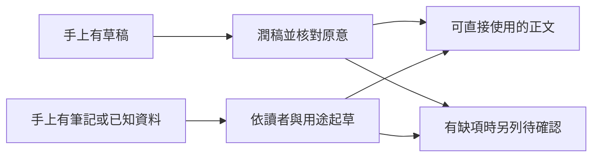

# Toolkit_Humanizer_Zh-TW

讓台灣繁中的工作文字讀起來自然一點，也讓讀者一眼找到重點。貼上草稿，可以拿到潤飾版。手上只有筆記、數據或案件紀錄，也可以整理成一份可使用的稿件。

適合用在**客服回覆、工作報告、操作說明與 SOP、對外公告及事故通知、行銷文案**。日期、條件、步驟和承諾會跟著原資料走。少了會影響答案的資訊時，會另列待確認事項。

## 先試這一句

第一次使用請先[安裝兩個技能目錄](#安裝)。在 Claude Code 輸入 `/humanize-tw`，在 Codex 輸入 `$humanize-tw`，接著貼上草稿或資料。告訴它這份文字要給誰看，會更容易選對語氣。

> 請根據案件紀錄寫一則可以直接貼給客戶的回覆。已收到退款申請，目前尚未核准。依政策，核准後預計 3 到 5 個工作天退回原付款方式。請只寫目前狀態和退款條件，省略素材未提供的審核期限與通知承諾。

例如，下面這段可以直接貼給客戶。

> 您好，我們已收到您的退款申請，目前尚未核准。若審核通過，款項預計會在核准後 3 到 5 個工作天內退回原付款方式。

## 兩種用法



| 何時用 | 可以這樣開口 |
| --- | --- |
| **客服回覆** | 「客戶問什麼時候收到退款。請依這筆案件和政策寫回覆，能直接貼給客戶。」 |
| **工作報告** | 「依這幾筆數據寫給主管看的週報。把觀察和原因分開，保留統計口徑。」 |
| **操作說明與 SOP** | 「把這兩個版本的操作筆記整理成 SOP。保留按鈕原名，缺一步就列待確認。」 |
| **公告與事故通知** | 「用目前已確認的範圍和時間寫一則事故通知，讓受影響的人知道可先怎麼做。」 |
| **行銷與品牌文案** | 「依規格寫給第一次挑選這類產品的人看。品牌語氣平實，主要行動是查看尺寸。」 |

如果草稿有一條時限，但案件紀錄或政策寫得不同，可以一併提供，並說明哪份資料是目前的依據。

## 前後對照

以下是用法示意。每組都保留了會影響讀者判斷或行動的資訊。

### 客服先回答查詢

**改前**

> 首先非常感謝您在這段期間的耐心等候與理解。我們已收到您寄回的商品，但退款作業尚未開始。完成退刷後，實際入帳日期依發卡銀行作業而定。您可至「訂單紀錄」查看退款狀態。

**改後**

> 您好，我們已收到您寄回的商品，退款作業尚未開始。完成退刷後，入帳日期依發卡銀行作業而定。您可在「訂單紀錄」查看退款狀態。

### 公告把影響和替代做法放前面

**改前**

> 謹向各位提供本次情形的完整說明。我們於台灣時間 18:10 首次接獲回報，已確認台灣區網頁版的發票下載受影響。實際開始時間尚未確認。急需發票者可使用先前已寄出的發票郵件，修復時間尚未確認。

**改後**

> 台灣區網頁版的發票下載受影響。急需發票時，可以從先前寄出的發票郵件取得。\
> 我們在台灣時間 18:10 首次接獲回報。實際影響開始時間和修復時間尚未確認。

### SOP 把動作和等待條件寫清楚

**改前**

> 這項操作僅適用桌面版 2.4.1，由 Workspace Admin 執行。操作前必須完成當日備份，並確認工作佇列為空。首先開啟「Batch Jobs」，進行點選「Pause New Jobs」的操作，須等到畫面顯示「Paused」，始可點選「Export Log」。

**改後**

> 僅適用於桌面版 2.4.1，由 Workspace Admin 執行。開始前，請完成當日備份，並確認工作佇列為空。
>
> 1. 開啟「Batch Jobs」。
> 2. 點選「Pause New Jobs」。
> 3. 等畫面顯示「Paused」後，再點選「Export Log」。

### 草稿以外也能直接給素材

| 手上有的資料 | 可以交付的結果 |
| --- | --- |
| 本週收到 18 件申請、核准 6 件，沒有提供核准件的收件日期 | 「本週收到 18 件申請，核准 6 件。」保留兩個統計口徑。 |
| 通勤收納包有三個內袋及拉鍊，行動是「查看尺寸」 | 「三個內袋可分開收納通勤小物，收好後拉上拉鍊。查看尺寸。」 |

## 安裝

### 讓 AI 幫你安裝

在你要使用這個技能的專案中，開啟 Codex 或 Claude Code，直接貼上這段。

```text
請幫我把台灣繁中工作寫作技能安裝到目前開啟的專案。
安裝說明 https://github.com/BlekZz/Toolkit_Humanizer_Zh-TW#安裝

請從 GitHub Release 下載 Toolkit_Humanizer_Zh-TW-skills.zip，依我正在使用的工具把 humanize-tw 和 tw-work-writing 兩個目錄一起安裝到本專案。請保留我的全域設定。裝好後，確認兩個目錄各有 SKILL.md，並告訴我在新聊天中要輸入哪個技能名稱。
```

### 自己安裝

1. 下載並解壓 [雙技能安裝包 `Toolkit_Humanizer_Zh-TW-skills.zip`](https://github.com/BlekZz/Toolkit_Humanizer_Zh-TW/releases/download/v1.0.0/Toolkit_Humanizer_Zh-TW-skills.zip)。它是 Release 附件，在 **Assets** 底下。
2. 在要使用這個技能的專案資料夾中，依下表建立對應的 `skills/` 目錄。把解壓後的 `humanize-tw/` 和 `tw-work-writing/` 兩個完整目錄直接放進去。
3. 回到同一個專案開新聊天，輸入技能名稱，接著貼上草稿或素材。可以先用上方的退款範例測試。

| 工具 | 兩個目錄都放在專案下的 | 在新聊天中輸入 |
| --- | --- | --- |
| Codex | `.agents/skills/` | `$humanize-tw` |
| Claude Code | `.claude/skills/` | `/humanize-tw` |

以 Codex 為例，安裝後應該看到這兩個檔案和 `references/` 目錄。Claude Code 的結構相同，第一層改成 `.claude/`。

```text
你的專案/
└── .agents/skills/
    ├── humanize-tw/
    │   └── SKILL.md
    └── tw-work-writing/
        ├── SKILL.md
        └── references/
```

- **找不到技能**。先確認聊天開在你安裝的專案，`skills/` 底下直接就是兩個技能目錄。如果在 Codex Desktop，請選取該資料夾並開一個 Local 聊天。
- **找不到主技能或參考檔**。用雙技能 ZIP，確認兩個目錄並排，而且 `references/` 隨 `tw-work-writing/` 一起複製。
- **Windows Codex CLI 回報 `setup refresh had errors`**。可在 Codex Desktop 選同一個專案資料夾，開 Local 聊天重試。

已有 [原版單技能 ZIP](https://github.com/BlekZz/Toolkit_Humanizer_Zh-TW/releases/download/v1.0.0/tw-work-writing-v1.0.0.zip) 時，可以直接用 `$tw-work-writing` 或 `/tw-work-writing`。要使用短入口請安裝雙技能 ZIP。

[Codex 安裝說明](https://developers.openai.com/codex/skills) · [Claude Code 安裝說明](https://code.claude.com/docs/en/skills)

<details>
<summary>原版驗收與設計來源</summary>

原版包含 [36 個合成驗收案例](evals/cases.json)，涵蓋根據資料起草與潤稿。Codex Desktop Local 和 Claude Code 都已用 GitHub Release 的雙技能 ZIP 重裝，讀取客服參考檔並完成成稿。[乾淨專案重裝驗收](dev/Reference_release_v1.0.0.md#github-release-乾淨專案重裝驗收)

- 整段模板腔的判斷參考 [writing-humanizer](https://github.com/shyuan/writing-humanizer)。
- 依文體保護常見台灣用語與反例設計參考 [writing-skills.TW](https://github.com/aeopress/writing-skills.TW)。
- 對讀原稿與改稿的檢查思路參考 [zh-tw-humanizer](https://github.com/acchuang/zh-tw-humanizer)。
- 防止誤改及客服資訊順序參考 [Speak Human TW](https://github.com/Raymondhou0917/speak-human-tw) 與 [Apple 台灣退款說明](https://support.apple.com/zh-tw/118224)。

</details>

本專案採 [MIT 授權](LICENSE)。
